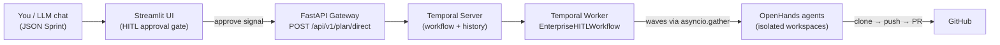

 English | [Русский](README.ru.md)

# agent-orchestrator-lite

<p align="center">
  <a href="LICENSE"></a>
  <a href="#"></a>
  <a href="#"></a>
  <a href="#"></a>
  <a href="#"></a>
  <a href="#"></a>
  <a href="#"></a>
  <a href="https://github.com/kartemiev/agent-orchestrator-lite"></a>
  <a href="https://github.com/kartemiev/agent-orchestrator-lite"></a>
</p>

A lightweight, production-ready Open-Source infrastructure for autonomous
execution of complex features and refactoring tasks using AI agents (OpenHands)
managed by Temporal.

### Why this project?
When delegating a large or complex feature (e.g., "build a notification service
with tests") to a single AI agent prompt, agents often hallucinate, lose
context, or break the existing codebase.

`agent-orchestrator-lite` solves this through **DAG Orchestration**:
- **Structured Planning:** You (or an external LLM chat like ChatGPT/Claude)
  decompose a feature into a graph of independent steps (a JSON Sprint).
- **Human-in-the-Loop Safety:** You review and approve the plan in a Streamlit
  UI before a single line of code is written.
- **Parallel Wave Execution:** The orchestrator runs independent tasks
  concurrently in isolated workspaces using Temporal and OpenHands.
- **Automated Delivery:** Once all tasks and tests complete successfully,
  changes are automatically committed, pushed to GitHub, and wrapped into a
  Pull Request.

## Contents

- [Lite vs Enterprise](#lite-vs-enterprise)
- [Key Concepts & Glossary](#key-concepts--glossary)
  - [Sprint (Execution Plan)](#sprint-execution-plan)
  - [DAG (Directed Acyclic Graph)](#dag-directed-acyclic-graph)
  - [Wave Execution](#wave-execution)
  - [Human-in-the-Loop (HITL)](#human-in-the-loop-hitl)
- [What's inside](#whats-inside)
  - [How the components talk](#how-the-components-talk)
- [Screenshots](#screenshots)
- [What was removed compared to the full version](#what-was-removed-compared-to-the-full-version)
- [Quick start](#quick-start)
- [Production Deployment & Security](#production-deployment--security)
- [Running a workflow](#running-a-workflow)
  - [Via the REST API](#via-the-rest-api)
  - [Via the UI](#via-the-ui)
  - [Via the CLI](#via-the-cli)
- [JSON plan format](#json-plan-format)
- [Usage examples](#usage-examples)
  - [Repository self-update](#repository-self-update)
- [Environment variables](#environment-variables)
  - [Resource Limits & Memory Recommendations](#resource-limits--memory-recommendations)
- [Structure](#structure)

## Lite vs Enterprise

`agent-orchestrator-lite` is the public minimal core of the full
`agent-orchestrator`, focused on one reliable scenario: run a pre-built JSON
plan through OpenHands under Temporal control.

| Capability | Lite (this repo) | Enterprise (full) |
|---|---|---|
| DAG Orchestration (Temporal) | ✅ | ✅ |
| Parallel wave execution | ✅ | ✅ |
| Human-in-the-Loop approval gate | ✅ | ✅ |
| Agent engine | ✅ OpenHands | ✅ multi-engine |
| Agents / workers | OpenHands | OpenHands + aider + AITM + dogfood + swarm |
| LLM Planner (auto-decomposition) | ❌ (external LLM chat) | ✅ built-in |
| Council of Elders (multi-model review) | ❌ | ✅ |
| Canvas fast-path | ❌ | ✅ |
| LLM providers | DeepSeek / OpenAI / Anthropic / OpenRouter | + SiliconFlow / DashScope / Resend |
| GitHub delivery (commit → push → PR) | ✅ | ✅ |

Details of what was removed: [What was removed compared to the full version](#what-was-removed-compared-to-the-full-version).

## Key Concepts & Glossary

Four terms explain almost everything about how the orchestrator thinks. Read
this before the architecture section — everything below builds on these ideas.

| Term | In one sentence | Everyday analogy |
|---|---|---|
| **Sprint** (Execution Plan) | One JSON document describes the whole feature. | A recipe for the entire dinner, not one chopped onion. |
| **DAG** | A step graph where `depends_on` sets the arrows. | A to-do list where some items block others. |
| **Wave Execution** | All unblocked steps of one level run in parallel. | Several cooks, each starting their own dish. |
| **Human-in-the-Loop (HITL)** | A human approves the plan before the first agent starts. | The pre-flight checklist signed by the pilot. |

### Sprint (Execution Plan)

A **sprint** is the unit of work: one JSON plan = one workflow = one isolated
workspace `/app/workspace/runs/{workflow_id}`. The plan does not describe *how*
to write the code — it describes *which* steps to run, with which model and in
which order. Example: [`self-update.json`](./examples/self-update.json) is a
sprint of 5 steps.

```json
{
  "graph_name": "Self-Update Sprint",
  "tasks": [{ "id": "task_0_git_sync", "depends_on": [], "engine": "openhands" }]
}
```

### DAG (Directed Acyclic Graph)

Steps form a graph, not a flat list. Each step declares its prerequisites in
`depends_on`, and may start only when every id listed there is done.

- **Directed** — dependencies have a direction: `git-sync → backend`, never back.
- **Acyclic** — no loops. If A waits for B and B waits for A, the workflow stops
  with `RuntimeError: cyclic dependency or unreachable step`.

```
Wave 1          Wave 2                      Wave 3     Wave 4
git-sync ──┬──→ backend/docs ──┐
           └──→ ui           ──┴──────────→ tests ───→ deliver (PR)
```

### Wave Execution

A **wave** is one "floor" of the DAG: every step that is ready at the same
moment. The executor collects the ready steps and launches them concurrently
with `asyncio.gather`, waits for the whole wave, then computes the next one.

- Parallelism is defined **only** by `depends_on`. `priority` changes nothing
  here and never makes independent steps wait for each other.
- The wave width is capped by `wave_max_concurrency` (per plan / per request) or
  by `WAVE_MAX_CONCURRENCY` (default `4`, ceiling `32`); extra ready steps are
  started in batches.
- A failure is isolated: the failed step is dropped, steps depending on it are
  skipped, and independent steps of the same wave still finish.
- The final `git push` + Pull Request delivery runs only if no step failed.

### Human-in-the-Loop (HITL)

Before Wave 1 runs, the workflow parks at an approval gate: it publishes the
parsed plan and waits for a signal.

| Signal / flag | Effect |
|---|---|
| `approve_plan_signal` | The plan is accepted — and may even be corrected by the human before launch. |
| `reject_plan_signal` | The plan is rejected with a reason; nothing is executed. |
| `auto_approve` | The gate is skipped for trusted, ready-made plans (Streamlit checkbox or `"auto_approve": true` in the API call). |

The gate is what makes it safe to hand a whole feature to the orchestrator: the
human reviews the decomposition, not every generated line of code.

## What's inside

- **FastAPI Gateway** (`orchestrator/main.py`) — `GET /health` and `POST /api/v1/plan/direct`.
- **Temporal Server + Postgres** (`temporal`, `temporal-db`) — orchestration and workflow history.
- **OpenHands** (`openhands`) — the agent that executes the phases of a DAG plan (terminal + file_editor).
- **Single worker** (`orchestrator/worker.py`) — registers only
  `EnterpriseHITLWorkflow` and the base activities.
- **Streamlit Dashboard** (`agent-ui`) — JSON plan input, auto-approve and
  workflow monitoring/signals.

### How the components talk



> Host-facing ports (`8085`, `8501`, `8000`, `7233`) are mapped in
> `docker-compose.yml` from `.env` variables (`ORCHESTRATOR_GATEWAY_PORT`,
> `STREAMLIT_PORT`, `AGENT_CANVAS_PORT`, `TEMPORAL_PORT`); inside the Docker
> network the components talk by service name (`agent-ui:8501`,
> `agent-orchestrator:8000`, `openhands:8000`, `temporal:7233`).

## Screenshots

Captured from the live stack at 1920×1080.

| | |
|---|---|
| **Streamlit Dashboard** — JSON plan input, `Auto-approve`, `Run` | **DAG execution view** — workflow status and the expanded plan |
|  |  |

**CLI diagnostics** — `agent-cli.py list` / `status` / `inspect` against the live stack:


Planned assets (to be added):

| File | Description |
|---|---|
| `docs/assets/streamlit-approval.png` | The HITL approval gate (approve / reject signals). |
| `docs/assets/temporal-ui.png` | Temporal UI: a running workflow with waves and step statuses. |
| `docs/assets/pull-request.png` | The auto-created GitHub Pull Request. |
| `docs/assets/demo.gif` | 30-second full-flow demo (plan → run → waves → PR). |

## What was removed compared to the full version

- The `agent-aider`, `agent-aitm`, `agent-dogfood`, `agent-swarm` workers and queues.
- The Council of Elders (Council), `council_panel.json`,
  `scripts/multi_model_review_dispatcher.py` and all their dependencies.
- The LLM Planner (auto-decomposition via DeepSeek) and the
  OpenRouter / SiliconFlow / DashScope / Resend integrations.
- The Canvas fast-path (`canvas_claude_streamer.py`, `canvas_bridge.py`).
- The `scripts/` folder and the extra specifications/blueprints.

## Quick start

```bash
cd agent-orchestrator-lite
cp .env.example .env        # fill in LLM_API_KEY and GITHUB_TOKEN
docker compose up -d
```

Once everything is up (host ports are read from `.env`, defaults shown in
brackets; `BIND_IP` selects the interface, default `127.0.0.1`):

| Service | Address | `.env` variable |
|---|---|---|
| Gateway API | `http://127.0.0.1:${ORCHESTRATOR_GATEWAY_PORT:-8085}` (health: `/health`) | `ORCHESTRATOR_GATEWAY_PORT` |
| Streamlit UI | `http://127.0.0.1:${STREAMLIT_PORT:-8501}` | `STREAMLIT_PORT` |
| Temporal UI | `http://127.0.0.1:8233` | — |
| OpenHands | `http://127.0.0.1:${AGENT_CANVAS_PORT:-8000}` | `AGENT_CANVAS_PORT` |
| Temporal (gRPC) | `${BIND_IP:-127.0.0.1}:${TEMPORAL_PORT:-7233}` | `TEMPORAL_PORT` |

Shutdown: `docker compose down`.

## Production Deployment & Security

The stack above listens on `127.0.0.1` only. Before exposing it to the internet
(Streamlit UI, Gateway API, webhooks), follow the dedicated guide:

📘 **[Securing a public deployment with Nginx Proxy Manager and Cloudflare Access](docs/deployment/securing-with-npm-and-cloudflare.md)**

It covers, step by step:

- **Nginx Proxy Manager** — proxy hosts for `agent-ui:8501` and
  `agent-orchestrator:8000`, a reusable **Access List** (HTTP Basic Auth), and
  importing a **custom SSL certificate** (StartSSL / Custom CRT + Key, or a
  Cloudflare Origin CA certificate).
- **⚠️ `Websockets Support`** — the toggle that must be ON for the Streamlit
  host; without it the dashboard loads but hangs on “Please wait…” /
  “Connection error”.
- **Cloudflare Zero Trust / Access** — an Access application with **Email PIN /
  OTP** login for the UI, plus **Bypass / service-token rules** for `/api/*` and
  `/webhook/*` so CI and GitHub webhooks are not blocked by the identity gate.
- Verification commands (`curl`, `openssl`, WebSocket probe), a troubleshooting
  table and a security checklist.

Russian version: [`securing-with-npm-and-cloudflare.ru.md`](docs/deployment/securing-with-npm-and-cloudflare.ru.md).

## Running a workflow

### Via the REST API

```bash
curl -X POST http://127.0.0.1:${ORCHESTRATOR_GATEWAY_PORT:-8085}/api/v1/plan/direct \
  -H 'Content-Type: application/json' \
  -d '{"raw_json": "{\"tasks\": [{\"id\": \"step_1\", \"title\": \"Hello\", \"prompt\": \"Create a hello.txt file containing hi\", \"depends_on\": [], \"engine\": \"openhands\"}]}", "auto_approve": true}'
```

Response: `{"status": "triggered", "workflow_id": "direct-plan-...", ...}`.

### Via the UI

1. Paste a ready-made JSON plan into the "Ready-made JSON plan" field.
2. Tick `Auto-approve` (or approve the plan manually in the monitoring panel).
3. Press "Run".

### Via the CLI

The repository ships a dependency-free CLI for launching and deep-diagnosing
sprints: [`scripts/agent-cli.py`](./scripts/agent-cli.py). It runs both from the
host and inside the orchestrator container.

```bash
# Launch a sprint (auto-approve + wait for completion)
python scripts/agent-cli.py submit examples/self-update.json --auto-approve --wait

# Brief status of waves and tasks
python scripts/agent-cli.py status <workflow_id>

# Deep inspection: DAG steps -> OpenHands sessions, container states, errors
python scripts/agent-cli.py inspect <workflow_id>

# Targeted logs (orchestrator + OpenHands)
python scripts/agent-cli.py logs <workflow_id> [--phase <task_id>]

# LLM (DeepSeek) diagnosis of a failed sprint
python scripts/agent-cli.py diagnose <workflow_id>

# List sprints (workflows) for the last 24 hours
python scripts/agent-cli.py list --since 24h --limit 20
```

`list` queries Temporal for active and finished sprints (`RUNNING`,
`COMPLETED`, `FAILED`, `TERMINATED`) within the requested window and prints a
table with the columns **Workflow ID**, **Status**, **Start Time** and
**Duration / Finished**. `--since` accepts `24h`, `1h30m`, `45m`, `2d`, `30s`
(default `24h`); `--limit` caps the number of rows (default `20`).

From the host the CLI talks to the HTTP gateway and the Docker CLI; for
Temporal-heavy commands it re-runs itself inside the orchestrator container via
`docker exec`. It also works directly inside the container:

```bash
docker compose exec agent-orchestrator python /app/scripts/agent-cli.py status <workflow_id>
# or, using the container name from docker-compose.yml:
docker exec agent-orchestrator-lite python /app/scripts/agent-cli.py status <workflow_id>
```

Run `python scripts/agent-cli.py --help` for the full list of commands and options.

For the guidance given to AI agents working on this repository (how to check
sprint status, self-diagnose failed runs and read logs before editing code or
JSON plans), see [`AGENTS.md`](./AGENTS.md) → "CLI Diagnostics & Control Tool".

## JSON plan format

```json
{
  "reasoning": "Optional rationale",
  "tasks": [
    {
      "id": "step_1",
      "title": "Git Sync",
      "prompt": "Clone the repository https://github.com/owner/repo and prepare the environment.",
      "depends_on": [],
      "model": "deepseek-v4-pro",
      "engine": "openhands"
    },
    {
      "id": "step_2",
      "title": "Create the model",
      "prompt": "Create the Pydantic model User in the file app/models.py",
      "depends_on": ["step_1"],
      "engine": "openhands"
    }
  ]
}
```

- `id` — unique step identifier (generated as `task_N` when omitted).
- `depends_on` — list of step ids the step depends on. Parallelism is driven
  solely by `depends_on`: steps with the same set of dependencies are executed
  in one wave via `asyncio.gather`.
- `prompt` — instruction for the OpenHands agent.
- `engine` — in the Lite version the only engine is `openhands` (all steps,
  including git-sync, are executed by OpenHands).
- `model` — optional per-node LLM model (otherwise `LLM_MODEL` from `.env`). The name can be a base name (`deepseek-v4-pro`, `gpt-4o`) or carry a LiteLLM prefix (`openrouter/...`, `deepseek/...`).

The full format specification and the DAG-building rules for an LLM architect
live in [`AGENTS.md`](./AGENTS.md) (a system prompt for ChatGPT / Claude / DeepSeek).

The wave-based DAG executor runs the steps strictly according to the submitted
plan: a wave of ready tasks is launched in parallel, a single failing task is
isolated (dependent steps are skipped), and at the end the final `git push` + PR
delivery and workspace cleanup happen.

## Usage examples

📘 **[End-to-end tutorial: building a feature with ChatGPT + Streamlit](docs/examples/notification-service.md)** —
a start-to-finish scenario: design a DAG plan in an external LLM chat and run it
in the orchestrator (ready plan: [`notification-service.json`](./examples/notification-service.json)).

### Repository self-update

The ready-made "the orchestrator updates itself" example lives in
[`self-update.json`](./examples/self-update.json), and its detailed description
is in [`self-update.md`](./docs/examples/self-update.md).

Short run via cURL (the plan is taken from the file directly):

```bash
curl -X POST http://localhost:${ORCHESTRATOR_GATEWAY_PORT:-8085}/api/v1/plan/direct \
  -H "Content-Type: application/json" \
  -d @examples/self-update.json
```

The same with Auto-approve (no manual confirmation):

```bash
curl -X POST http://localhost:${ORCHESTRATOR_GATEWAY_PORT:-8085}/api/v1/plan/direct \
  -H "Content-Type: application/json" \
  -d "$(python3 -c 'import json; d=json.load(open("examples/self-update.json")); print(json.dumps({"raw_json": json.dumps(d), "auto_approve": True}))')"
```

The plan contains 5 tasks across 4 waves: `git-sync` → parallel
`backend/docs` + `ui` → `tests` → `deliver` (commit + push + PR).

## Environment variables

See [`.env.example`](./.env.example). Detailed configuration of LLM providers
(OpenAI / Anthropic / OpenRouter / DeepSeek) and of the OpenHands container is described in
[`openhands-setup.md`](./docs/openhands-setup.md). The key ones:

| Variable | Description | Default |
|---|---|---|
| `LLM_API_KEY` | LLM key for OpenHands | — |
| `LLM_MODEL` | Global model (from `.env`; base name or LiteLLM prefix) | `deepseek-v4-pro` |
| `GITHUB_TOKEN` | For cloning and creating PRs | — |
| `GIT_TERMINAL_PROMPT` | Disable interactive git prompts (prevents agent hangs) | `0` |
| `BIND_IP` | IP used to publish ports | `127.0.0.1` |
| `ORCHESTRATOR_GATEWAY_PORT` | Host port for the Gateway API | `8085` |
| `STREAMLIT_PORT` | Host port for the Streamlit UI | `8501` |
| `AGENT_CANVAS_PORT` | Host port for OpenHands / agent-canvas | `8000` |
| `TEMPORAL_PORT` | Host port for the Temporal gRPC frontend | `7233` |
| `ORCHESTRATOR_MEM_LIMIT` | Container RAM limit for `agent-orchestrator` (cgroup) | `2g` |
| `OPENHANDS_MEM_LIMIT` | Container RAM limit for `openhands` (cgroup) | `4g` |
| `CLEANUP_WORKSPACE` | Remove the workspace after a workflow | `true` |
| `WAVE_MAX_CONCURRENCY` | DAG wave width | `4` |

### Resource Limits & Memory Recommendations

The stack caps container RAM with cgroup limits defined in `docker-compose.yml`:

| Variable | Applies to | Default |
|---|---|---|
| `ORCHESTRATOR_MEM_LIMIT` | `agent-orchestrator` (FastAPI Gateway + Temporal Worker) | `2g` |
| `OPENHANDS_MEM_LIMIT` | `openhands` (agent execution container) | `4g` |

`memswap_limit` is set equal to `mem_limit`, so containers cannot spill into
swap: under memory pressure they receive a predictable OOM-kill instead of
stalling the host.

`OPENHANDS_MEM_LIMIT=4g` is a good baseline for small tasks, Python scripts,
and `pytest` runs.

> **Important for developers:** when debugging and building Kotlin/Gradle or
> C++ projects, raise `OPENHANDS_MEM_LIMIT` in `.env` to at least `8g`–`12g`
> (or higher on a larger host). The Gradle Daemon together with the Kotlin
> compiler and native toolchains easily exceeds 4 GB, and an under-provisioned
> limit shows up as a Gradle Daemon **Out-Of-Memory (OOM)** crash in the middle
> of a build.

```bash
# .env — build-heavy workloads
OPENHANDS_MEM_LIMIT=12g
```

Recreate the container so the new cgroup limit takes effect:

```bash
docker compose up -d openhands
docker inspect openhands --format '{{.HostConfig.Memory}}'
```

## Structure

```
orchestrator/
  main.py        FastAPI Gateway
  worker.py      Temporal Worker
  workflows.py   EnterpriseHITLWorkflow (wave-based DAG executor)
  activities.py  execute_openhands_phase / prepare_workspace /
                 cleanup_workspace / git_push_and_create_pr
ui/
  app.py         Streamlit Dashboard
docker/
  openhands-entrypoint.sh
docker-compose.yml
scripts/
  agent-cli.py   CLI: submit / status / inspect / logs / diagnose / list
examples/
  self-update.json            JSON plan "repository self-update"
  notification-service.json   JSON plan "Notification Service"
docs/
  openhands-setup.md          OpenHands and LLM provider setup
  openhands-setup.ru.md       Same in Russian
  examples/
    self-update.md            Self-update example walkthrough
    self-update.ru.md         Same in Russian
    notification-service.md   End-to-end tutorial (ChatGPT → DAG → run)
    notification-service.ru.md  Same in Russian
  blueprints/
    tree-refactoring-blueprint.md     Tree refactoring blueprint
    tree-refactoring-blueprint.ru.md  Same in Russian
  deployment/
    securing-with-npm-and-cloudflare.md     NPM + Cloudflare Access public deploy
    securing-with-npm-and-cloudflare.ru.md  Same in Russian
AGENTS.md                     JSON plan specification for an LLM architect
AGENTS.ru.md                  Same in Russian
README.md                     Main README (English)
README.ru.md                  Main README (Russian)
.env.example                  Environment variables template (copy to .env)
.gitignore                    Ignored files (secrets, caches, artifacts)
.dockerignore                 Docker build ignore rules
LICENSE                       MIT
```
