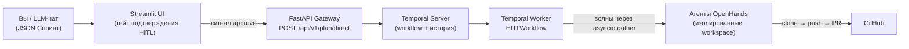
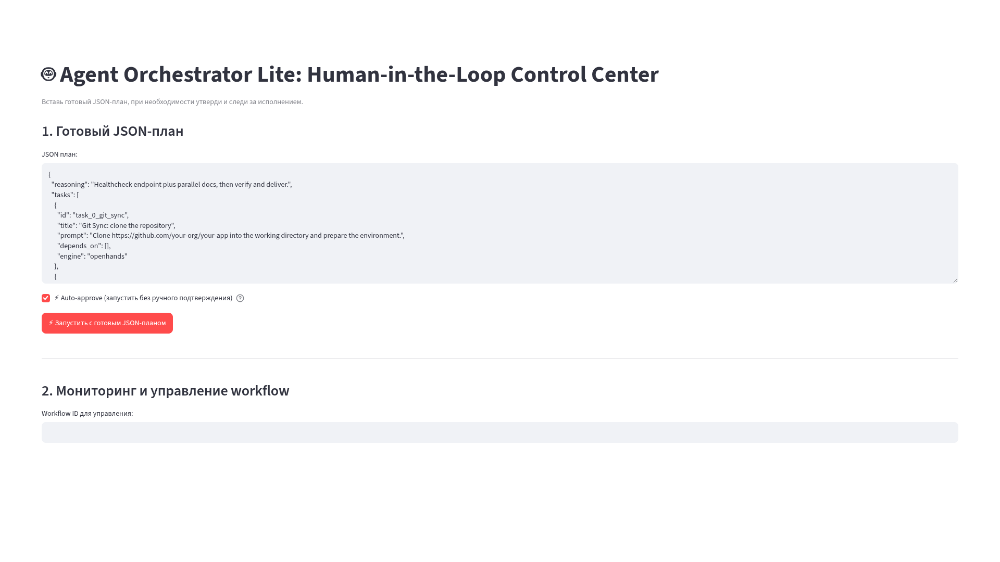
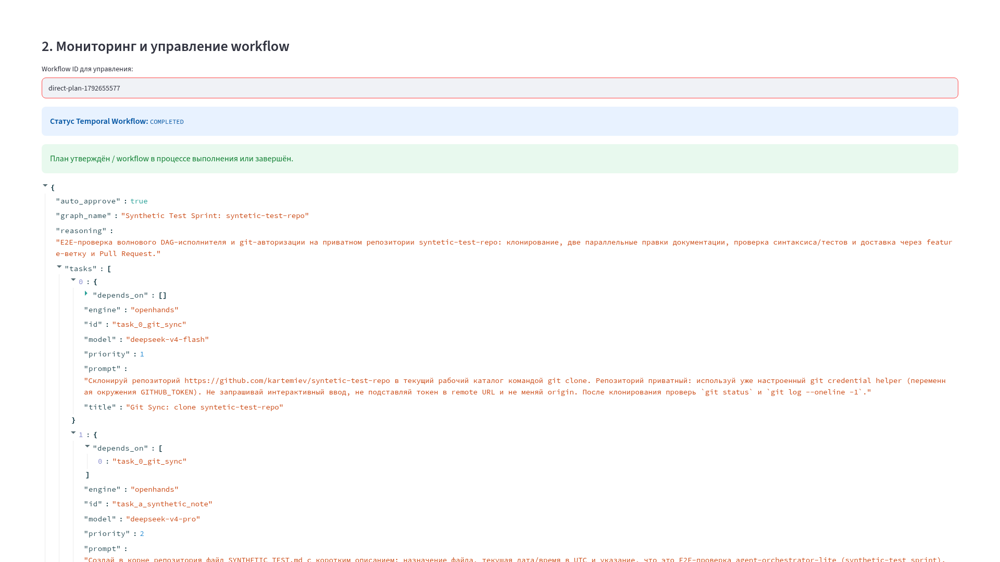
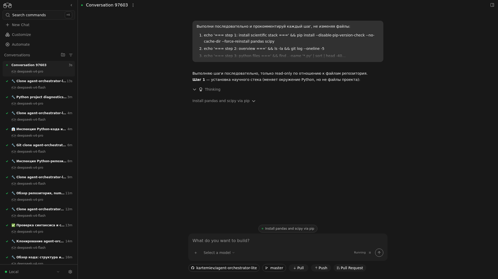
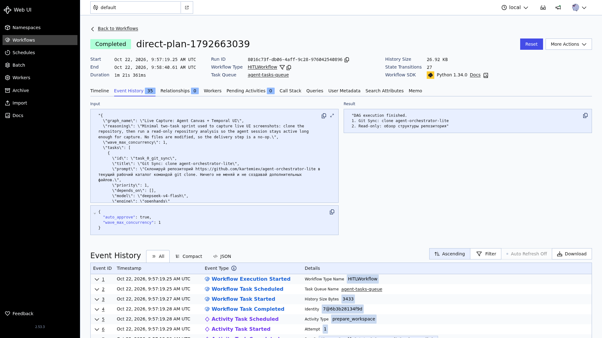
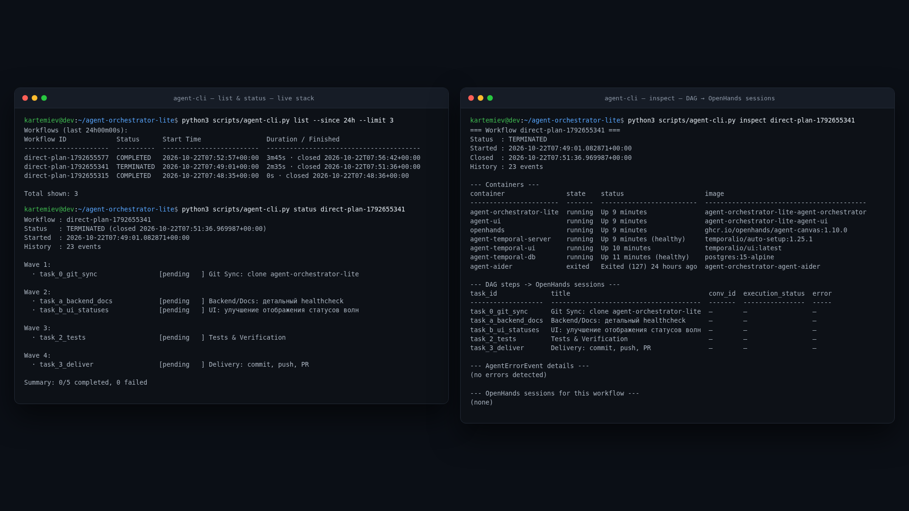

 [English](README.md) | Русский

# agent-orchestrator-lite

<p align="center">
  <a href="LICENSE"></a>
  <a href="https://www.python.org/"></a>
  <a href="https://fastapi.tiangolo.com/"></a>
  <a href="https://temporal.io/"></a>
  <a href="https://streamlit.io/"></a>
  <a href="https://github.com/All-Hands-AI/OpenHands"></a>
  <a href="https://docs.docker.com/compose/"></a>
  <a href="https://github.com/kartemiev/agent-orchestrator-lite"></a>
  <a href="https://github.com/kartemiev/agent-orchestrator-lite"></a>
</p>

`agent-orchestrator-lite` — готовая к продакшену Open-Source инфраструктура для
автономного исполнения сложных фич и рефакторинга AI-агентами (OpenHands) под
управлением Temporal.

### Зачем нужен этот проект?
При поручении AI-агенту крупной задачи (например, «напиши сервис уведомлений
с тестами») одиночный промпт часто приводит к галлюцинациям, потере контекста
и поломке репозитория.

`agent-orchestrator-lite` решает эту проблему через **DAG-оркестрацию**:
- **Структурированное планирование:** Вы (или внешний LLM-чат, например
  ChatGPT/Claude) декомпозируете фичу на граф независимых шагов (JSON Спринт).
- **Безопасность (Human-in-the-Loop):** Вы утверждаете план в Streamlit UI
  перед запуском первого агента.
- **Параллельное волновое исполнение:** Оркестратор запускает независимые
  задачи параллельными волнами в изолированном workspace с помощью Temporal
  и OpenHands.
- **Автоматическая доставка:** После успешного прогона всех задач и тестов
  изменения автоматически коммитятся, пушатся в GitHub и оформляются в
  Pull Request.

## Содержание

- [Концепции и терминология](#концепции-и-терминология)
  - [Спринт (Sprint / Execution Plan)](#спринт-sprint--execution-plan)
  - [DAG (Directed Acyclic Graph)](#dag-directed-acyclic-graph)
  - [Волна исполнения (Wave Execution)](#волна-исполнения-wave-execution)
  - [Human-in-the-Loop (HITL)](#human-in-the-loop-hitl)
- [Что внутри](#что-внутри)
  - [Как компоненты взаимодействуют](#как-компоненты-взаимодействуют)
- [Скриншоты](#скриншоты)
- [Быстрый старт](#быстрый-старт)
- [Продакшен и Безопасность](#продакшен-и-безопасность)
- [Запуск workflow](#запуск-workflow)
  - [Через REST API](#через-rest-api)
  - [Через UI](#через-ui)
  - [Через CLI](#через-cli)
- [Формат JSON-плана](#формат-json-плана)
- [Примеры использования](#примеры-использования)
  - [Самообновление репозитория](#самообновление-репозитория)
- [Переменные окружения](#переменные-окружения)
  - [Лимиты ресурсов и рекомендации по памяти](#лимиты-ресурсов-и-рекомендации-по-памяти)
- [Структура](#структура)
- [Contributing](#contributing)
- [Security](#security)
- [License](#license)

## Концепции и терминология

Четыре термина объясняют почти всё, что происходит внутри оркестратора.
Прочитайте этот раздел до описания архитектуры — всё дальнейшее опирается на
эти четыре идеи.

| Термин | Одной фразой | Бытовой аналог |
|---|---|---|
| **Спринт** (Execution Plan) | Один JSON-документ описывает фичу целиком. | Рецепт всего ужина, а не одной луковицы. |
| **DAG** | Граф шагов, где `depends_on` задаёт стрелки. | Список дел, где часть пунктов блокирует другие. |
| **Волна исполнения** | Все разблокированные шаги уровня идут параллельно. | Несколько поваров, каждый со своим блюдом. |
| **Human-in-the-Loop (HITL)** | Человек утверждает план до старта первого агента. | Предполётный чек-лист, который подписывает пилот. |

### Спринт (Sprint / Execution Plan)

**Спринт** — единица работы: один JSON-план = один workflow = один изолированный
workspace `/app/workspace/runs/{workflow_id}`. План не описывает, *как* писать
код, — он описывает, *какие* шаги выполнить, какой моделью и в каком порядке.
Пример: [`self-update.json`](./examples/self-update.json) — спринт из 5 шагов.

```json
{
  "graph_name": "Self-Update Sprint",
  "tasks": [{ "id": "task_0_git_sync", "depends_on": [], "engine": "openhands" }]
}
```

### DAG (Directed Acyclic Graph)

Шаги образуют граф, а не плоский список. Каждый шаг объявляет свои предпосылки
в `depends_on` и может стартовать только тогда, когда все перечисленные там id
завершены.

- **Directed (направленный)** — у зависимостей есть направление:
  `git-sync → backend`, но не обратно.
- **Acyclic (без циклов)** — петель нет. Если A ждёт B, а B ждёт A, workflow
  останавливается с `RuntimeError: cyclic dependency or unreachable step`.

```
Волна 1         Волна 2                     Волна 3    Волна 4
git-sync ──┬──→ backend/docs ──┐
           └──→ ui           ──┴──────────→ tests ───→ deliver (PR)
```

### Волна исполнения (Wave Execution)

**Волна** — это один «этаж» DAG: все шаги, готовые к запуску в один и тот же
момент. Исполнитель собирает готовые шаги и запускает их одновременно через
`asyncio.gather`, дожидается завершения всей волны, затем вычисляет следующую.

- Параллелизм задаётся **только** через `depends_on`. `priority` здесь ничего не
  меняет и никогда не заставляет независимые шаги ждать друг друга.
- Ширина волны ограничена `wave_max_concurrency` (в плане / в запросе) или
  `WAVE_MAX_CONCURRENCY` (по умолчанию `4`, потолок `32`); лишние готовые шаги
  запускаются батчами.
- Падение изолируется: упавший шаг отбрасывается, зависящие от него шаги
  пропускаются, а независимые шаги той же волны всё равно доходят до конца.
- Финальная доставка `git push` + Pull Request выполняется только при отсутствии
  сбоев.

### Human-in-the-Loop (HITL)

Перед запуском Волны 1 workflow останавливается на гейте подтверждения:
публикует разобранный план и ждёт сигнала.

| Сигнал / флаг | Что происходит |
|---|---|
| `approve_plan_signal` | План принят — человек может даже исправить его перед запуском. |
| `reject_plan_signal` | План отклонён с указанием причины; ничего не исполняется. |
| `auto_approve` | Гейт пропускается для доверенных готовых планов (чекбокс в Streamlit или `"auto_approve": true` в вызове API). |

Именно этот гейт делает безопасной передачу оркестратору целой фичи: человек
проверяет декомпозицию, а не каждую сгенерированную строку кода.

## Что внутри

- **FastAPI Gateway** (`orchestrator/main.py`) — `GET /health` и `POST /api/v1/plan/direct`.
- **Temporal Server + Postgres** (`temporal`, `temporal-db`) — оркестрация и история workflow.
- **OpenHands** (`openhands`) — агент, исполняющий фазы DAG-плана (terminal + file_editor).
- **Единый воркер** (`orchestrator/worker.py`) — регистрирует `HITLWorkflow`
  и базовые активности.
- **Streamlit Dashboard** (`agent-ui`) — ввод JSON-плана, auto-approve и
  мониторинг/сигналы workflow.

### Как компоненты взаимодействуют



> Хостовые порты (`8085`, `8501`, `8000`, `7233`) мапятся в
> `docker-compose.yml` из переменных `.env` (`ORCHESTRATOR_GATEWAY_PORT`,
> `STREAMLIT_PORT`, `AGENT_CANVAS_PORT`, `TEMPORAL_PORT`); внутри Docker-сети
> компоненты общаются по именам сервисов (`agent-ui:8501`,
> `agent-orchestrator:8000`, `openhands:8000`, `temporal:7233`).

## Скриншоты

Сняты с живого стека в разрешении 1920×1080.

| | |
|---|---|
| **Streamlit Dashboard** — ввод JSON-плана, `Auto-approve`, `Run` | **DAG execution view** — статус workflow и раскрытый план |
|  |  |
| **Agent Canvas session** — живая сессия OpenHands, исполняющая шаг DAG | **Temporal UI** — Event History с активностями workflow |
|  |  |

**CLI-диагностика** — `agent-cli.py list` / `status` / `inspect` на живом стеке:



Планируемые ассеты (будут добавлены):

| Файл | Описание |
|---|---|
| `docs/assets/streamlit-approval.png` | Гейт подтверждения HITL (сигналы approve / reject). |
| `docs/assets/pull-request.png` | Автоматически созданный GitHub Pull Request. |
| `docs/assets/demo.gif` | Демо полного цикла за 30 секунд (план → запуск → волны → PR). |

## Быстрый старт

**Требования:** Docker Engine + Docker Compose v2, ≥8 ГБ RAM и ключ LLM API
(`LLM_API_KEY`).

```bash
cd agent-orchestrator-lite
cp .env.example .env        # заполните LLM_API_KEY и GITHUB_TOKEN
docker compose up -d
```

После старта (хостовые порты берутся из `.env`, в скобках — дефолты;
`BIND_IP` выбирает интерфейс, по умолчанию `127.0.0.1`):

| Сервис | Адрес | Переменная `.env` |
|---|---|---|
| Gateway API | `http://127.0.0.1:${ORCHESTRATOR_GATEWAY_PORT:-8085}` (health: `/health`) | `ORCHESTRATOR_GATEWAY_PORT` |
| Streamlit UI | `http://127.0.0.1:${STREAMLIT_PORT:-8501}` | `STREAMLIT_PORT` |
| Temporal UI | `http://127.0.0.1:8233` | — |
| OpenHands | `http://127.0.0.1:${AGENT_CANVAS_PORT:-8000}` | `AGENT_CANVAS_PORT` |
| Temporal (gRPC) | `${BIND_IP:-127.0.0.1}:${TEMPORAL_PORT:-7233}` | `TEMPORAL_PORT` |

Остановка: `docker compose down`.

## Продакшен и Безопасность

Стек выше слушает только `127.0.0.1`. Прежде чем открывать его в интернет
(Streamlit UI, Gateway API, вебхуки), пройдите отдельную инструкцию:

📘 **[Безопасный публичный деплой через Nginx Proxy Manager и Cloudflare Access](docs/deployment/securing-with-npm-and-cloudflare.ru.md)**

Что в ней есть, по шагам:

- **Nginx Proxy Manager** — proxy hosts для `agent-ui:8501` и
  `agent-orchestrator:8000`, переиспользуемый **Access List** (HTTP Basic Auth)
  и импорт **кастомного SSL-сертификата** (StartSSL / Custom CRT + Key либо
  сертификат Cloudflare Origin CA).
- **⚠️ `Websockets Support`** — тумблер, обязательный для Streamlit-хоста: без
  него дашборд загружается, но «висит» на «Please wait…» / «Connection error».
- **Cloudflare Zero Trust / Access** — Access-приложение с входом по **Email PIN /
  OTP** для UI и **исключения (Bypass) / service tokens** для `/api/*` и
  `/webhook/*`, чтобы CI и GitHub-вебхуки не блокировались авторизацией.
- Команды проверки (`curl`, `openssl`, проба WebSocket), таблица диагностики и
  чек-лист безопасности.

English version: [`securing-with-npm-and-cloudflare.md`](docs/deployment/securing-with-npm-and-cloudflare.md).

## Запуск workflow

### Через REST API

```bash
curl -X POST http://127.0.0.1:${ORCHESTRATOR_GATEWAY_PORT:-8085}/api/v1/plan/direct \
  -H 'Content-Type: application/json' \
  -d '{"raw_json": "{\"tasks\": [{\"id\": \"step_1\", \"title\": \"Hello\", \"prompt\": \"Создай файл hello.txt с текстом hi\", \"depends_on\": [], \"engine\": \"openhands\"}]}", "auto_approve": true}'
```

Ответ: `{"status": "triggered", "workflow_id": "direct-plan-...", ...}`.

### Через UI

1. Вставьте готовый JSON-план в поле «**1. Готовый JSON-план**».
2. Отметьте «**⚡ Auto-approve (запустить без ручного подтверждения)**»
   (или утвердите план вручную в панели мониторинга).
3. Нажмите «**⚡ Запустить с готовым JSON-планом**».

### Через CLI

В репозитории есть CLI без внешних зависимостей для запуска и глубокой
диагностики спринтов: [`scripts/agent-cli.py`](./scripts/agent-cli.py). Работает
и с хоста, и внутри контейнера оркестратора.

```bash
# Запуск спринта (auto-approve + дождаться завершения)
python3 scripts/agent-cli.py submit examples/self-update.json --auto-approve --wait

# Краткий статус волн и задач
python3 scripts/agent-cli.py status <workflow_id>

# Глубокая инспекция: шаги DAG -> сессии OpenHands, состояния контейнеров, ошибки
python3 scripts/agent-cli.py inspect <workflow_id>

# Точечные логи (оркестратор + OpenHands)
python3 scripts/agent-cli.py logs <workflow_id> [--phase <task_id>]

# LLM-диагностика (DeepSeek) упавшего спринта
python3 scripts/agent-cli.py diagnose <workflow_id>

# Список спринтов (workflow) за последние 24 часа
python3 scripts/agent-cli.py list --since 24h --limit 20
```

`list` запрашивает у Temporal активные и завершённые спринты (`RUNNING`,
`COMPLETED`, `FAILED`, `TERMINATED`) за указанный интервал и выводит таблицу с
колонками **Workflow ID**, **Status**, **Start Time** и **Duration / Finished**.
`--since` принимает `24h`, `1h30m`, `45m`, `2d`, `30s` (по умолчанию `24h`);
`--limit` ограничивает число строк (по умолчанию `20`).

С хоста CLI обращается к HTTP-шлюзу и к Docker CLI; для Temporal-команд он
перезапускает себя внутри контейнера оркестратора через `docker exec`. Он также
работает напрямую внутри контейнера:

```bash
docker compose exec agent-orchestrator python3 /app/scripts/agent-cli.py status <workflow_id>
# либо по имени контейнера из docker-compose.yml:
docker exec agent-orchestrator-lite python3 /app/scripts/agent-cli.py status <workflow_id>
```

Полный список команд и опций: `python3 scripts/agent-cli.py --help`.

Инструкция для AI-агентов, работающих с репозиторием (как проверять статус
спринтов, делать самодиагностику падений и читать логи перед правкой кода или
JSON-планов), — в [`AGENTS.md`](./AGENTS.ru.md) → «Инструмент диагностики и
управления CLI».

## Формат JSON-плана

```json
{
  "reasoning": "Необязательное обоснование",
  "tasks": [
    {
      "id": "step_1",
      "title": "Git Sync",
      "prompt": "Склонируй репозиторий https://github.com/owner/repo и подготовь окружение.",
      "depends_on": [],
      "model": "deepseek-v4-pro",
      "engine": "openhands"
    },
    {
      "id": "step_2",
      "title": "Создать модель",
      "prompt": "Создай Pydantic модель User в файле app/models.py",
      "depends_on": ["step_1"],
      "engine": "openhands"
    }
  ]
}
```

- `id` — уникальный идентификатор шага (если не задан, генерируется `task_N`).
- `depends_on` — список id шагов, от которых зависит шаг. Параллелизм задаётся
  только через `depends_on`: шаги с одинаковым набором зависимостей исполняются
  одной волной через `asyncio.gather`.
- `prompt` — инструкция для агента OpenHands.
- `engine` — единственный движок `openhands` (все шаги, включая git-sync,
  выполняются OpenHands).
- `model` — опциональная per-node LLM-модель (иначе `LLM_MODEL` из `.env`). Имя может быть базовым (`deepseek-v4-pro`, `gpt-4o`) или с LiteLLM-префиксом (`openrouter/...`, `deepseek/...`).

Спецификация формата и правила построения DAG для LLM-архитектора —
в [`AGENTS.md`](./AGENTS.ru.md) (системный промпт для ChatGPT / Claude / DeepSeek).

Волновой DAG-исполнитель исполняет шаги строго по переданному плану: волна
готовых задач запускается параллельно, падение одной задачи изолируется
(зависимые шаги пропускаются), в конце — финальная доставка `git push` + PR
и очистка workspace.

## Примеры использования

📘 **[Сквозной туториал: разработка фичи с ChatGPT + Streamlit](docs/examples/notification-service.ru.md)** —
сценарий «от и до»: проектируем DAG-план через внешний LLM-чат и исполняем его
в оркестраторе (готовый план: [`notification-service.json`](./examples/notification-service.json);
промпты на английском: [`notification-service-en.json`](./examples/notification-service-en.json)).

### Самообновление репозитория

Готовый пример «оркестратор обновляет сам себя» находится в
[`self-update.json`](./examples/self-update.json) (промпты на английском:
[`self-update-en.json`](./examples/self-update-en.json)), а его подробное
описание — в [`self-update.md`](./docs/examples/self-update.ru.md).

Короткий запуск через cURL (план берётся из файла напрямую):

```bash
curl -X POST http://localhost:${ORCHESTRATOR_GATEWAY_PORT:-8085}/api/v1/plan/direct \
  -H "Content-Type: application/json" \
  -d @examples/self-update.json
```

То же самое с Auto-approve (без ручного подтверждения):

```bash
curl -X POST http://localhost:${ORCHESTRATOR_GATEWAY_PORT:-8085}/api/v1/plan/direct \
  -H "Content-Type: application/json" \
  -d "$(python3 -c 'import json; d=json.load(open("examples/self-update.json")); print(json.dumps({"raw_json": json.dumps(d), "auto_approve": True}))')"
```

План содержит 5 задач в 4 волнах: `git-sync` → параллельные
`backend/docs` + `ui` → `tests` → `deliver` (commit + push + PR).

## Переменные окружения

См. [`.env.example`](./.env.example). Подробная настройка LLM-провайдеров
(OpenAI / Anthropic / OpenRouter / DeepSeek) и контейнера OpenHands — в
[`openhands-setup.md`](./docs/openhands-setup.ru.md). Ключевые:

| Переменная | Описание | По умолчанию |
|---|---|---|
| `LLM_API_KEY` | Ключ LLM для OpenHands | — |
| `LLM_MODEL` | Глобальная модель (из `.env`; базовое имя или LiteLLM-префикс) | `deepseek-v4-pro` |
| `GITHUB_TOKEN` | Для клонирования и создания PR | — |
| `GIT_TERMINAL_PROMPT` | Отключает интерактивные подсказки git (агент не зависает) | `0` |
| `BIND_IP` | IP публикации портов | `127.0.0.1` |
| `ORCHESTRATOR_GATEWAY_PORT` | Хост-порт Gateway API | `8085` |
| `STREAMLIT_PORT` | Хост-порт Streamlit UI | `8501` |
| `AGENT_CANVAS_PORT` | Хост-порт OpenHands / agent-canvas | `8000` |
| `TEMPORAL_PORT` | Хост-порт gRPC-фронтенда Temporal | `7233` |
| `ORCHESTRATOR_MEM_LIMIT` | Лимит RAM контейнера `agent-orchestrator` (cgroup) | `2g` |
| `OPENHANDS_MEM_LIMIT` | Лимит RAM контейнера `openhands` (cgroup) | `4g` |
| `CLEANUP_WORKSPACE` | Удалять workspace после workflow | `true` |
| `WAVE_MAX_CONCURRENCY` | Ширина волны DAG | `4` |

### Лимиты ресурсов и рекомендации по памяти

Стек ограничивает RAM контейнеров cgroup-лимитами, заданными в
`docker-compose.yml`:

| Переменная | Применяется к | По умолчанию |
|---|---|---|
| `ORCHESTRATOR_MEM_LIMIT` | `agent-orchestrator` (FastAPI Gateway + Temporal Worker) | `2g` |
| `OPENHANDS_MEM_LIMIT` | `openhands` (контейнер исполнения агента) | `4g` |

`memswap_limit` выставляется равным `mem_limit`, поэтому контейнеры не могут
уйти в swap: под давлением памяти они получают предсказуемый OOM-kill вместо
зависания хоста.

`OPENHANDS_MEM_LIMIT=4g` — хороший базовый лимит для небольших задач,
Python-скриптов и прогона `pytest`.

> **Важно для разработчиков:** при отладке и сборке Kotlin/Gradle или C++
> проектов увеличьте `OPENHANDS_MEM_LIMIT` в `.env` хотя бы до `8g`–`12g`
> (или выше, если позволяет хост). Gradle Daemon вместе с компилятором Kotlin
> и нативными тулчейнами легко превышает 4 ГБ, а заниженный лимит проявляется
> падением Gradle Daemon по **Out-Of-Memory (OOM)** прямо во время сборки.

```bash
# .env — нагрузки со сборкой
OPENHANDS_MEM_LIMIT=12g
```

Пересоздайте контейнер, чтобы новый cgroup-лимит применился:

```bash
docker compose up -d openhands
docker inspect openhands --format '{{.HostConfig.Memory}}'
```

## Структура

```
orchestrator/
  main.py        FastAPI Gateway
  worker.py      Temporal Worker
  workflows.py   HITLWorkflow (волновой DAG-исполнитель)
  activities.py  execute_openhands_phase / prepare_workspace /
                 cleanup_workspace / git_push_and_create_pr
ui/
  app.py         Streamlit Dashboard
docker/
  openhands-entrypoint.sh
docker-compose.yml
scripts/
  agent-cli.py   CLI: submit / status / inspect / logs / diagnose / list
examples/
  self-update.json            JSON-план «самообновление репозитория»
  self-update-en.json         То же, промпты на английском
  notification-service.json   JSON-план «Notification Service»
  notification-service-en.json  То же, промпты на английском
docs/
  openhands-setup.md          Настройка OpenHands и LLM-провайдеров
  openhands-setup.ru.md       То же на русском
  examples/
    self-update.md            Описание примера самообновления
    self-update.ru.md         То же на русском
    notification-service.md   Сквозной туториал (ChatGPT → DAG → запуск)
    notification-service.ru.md  То же на русском
  blueprints/
    tree-refactoring-blueprint.md     Blueprint рефакторинга дерева
    tree-refactoring-blueprint.ru.md  То же на русском
  deployment/
    securing-with-npm-and-cloudflare.md     NPM + Cloudflare Access: публичный деплой
    securing-with-npm-and-cloudflare.ru.md  То же на русском
AGENTS.md                     Спецификация JSON-планов для LLM-архитектора
AGENTS.ru.md                  То же на русском
README.md                     Главный README (English)
README.ru.md                  Главный README (Русский)
.env.example                  Шаблон переменных окружения (копируется в .env)
.gitignore                    Игнорируемые файлы (секреты, кэши, артефакты)
.dockerignore                 Правила исключения для сборки Docker
LICENSE                       MIT
```

## Contributing

Мы рады вкладу! См. [CONTRIBUTING.md](.github/CONTRIBUTING.md) — как сообщить об
ошибке, предложить фичу или открыть Pull Request.

## Security

Нашли уязвимость? Сообщите приватно — см. [SECURITY.md](.github/SECURITY.md).

## License

[MIT](LICENSE) © участники agent-orchestrator-lite.
