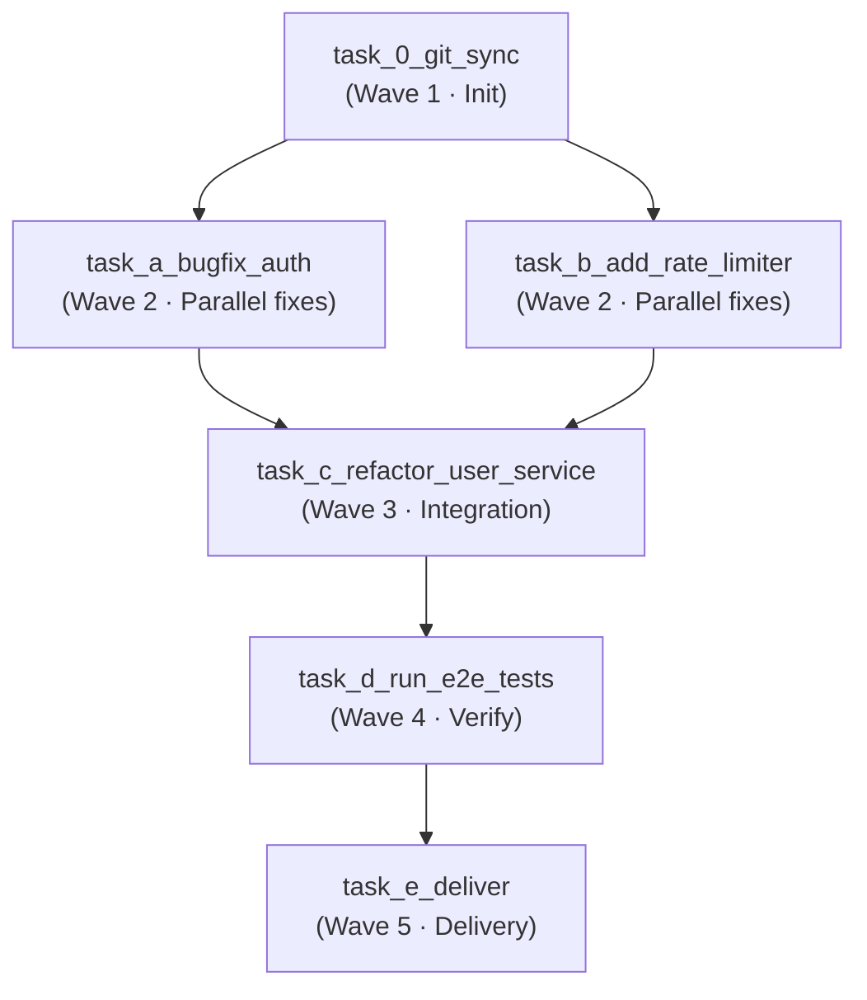

 English | [Русский](advanced-use-cases.ru.md)

# Advanced use case: Feature & Bug Bundling into a DAG sprint

A more advanced scenario than a single feature: instead of one large task, we
assemble a **release bundle** from several small backlog items (a bugfix, a
small feature and a refactor) into a single DAG sprint and execute it in
`agent-orchestrator-lite` via OpenHands + Temporal.

The ready-made JSON plans from this scenario live in the files
[`feature-bundle.json`](../../examples/feature-bundle.json) (Russian prompts) and
[`feature-bundle-en.json`](../../examples/feature-bundle-en.json) (English
prompts) — you can run either of them directly.

---

## Concept: Feature/Bug Bundle

In a classic backlog, small tasks live separately: "fix the auth refresh bug",
"add a rate limiter", "extract `UserService` from the controller". Running each
of them as a standalone workflow is wasteful:

- **Repeated overhead.** Every standalone sprint pays the fixed cost of
  `git-sync`, workspace preparation, test runs and delivery (commit + push + PR)
  — for a change of a few lines.
- **Serial review.** Each item produces its own Pull Request that has to be
  reviewed and merged separately.
- **No integration safety.** A refactor that touches code affected by the
  bugfix/feature is tested only after everything is merged, when a conflict or
  regression is already in `main`.

A **bundle** merges these items into **one DAG sprint with one delivery**:

- Independent items are placed into the **same wave** and executed in parallel
  (`asyncio.gather`), so the wall-clock time is defined by the slowest item, not
  by their sum.
- Items that touch the same code (the refactor over the freshly fixed auth /
  rate-limited endpoints) are scheduled **after** both parents — the DAG blocks
  them until the parallel wave finishes.
- One verification step and one delivery step cover the whole bundle → a single
  PR with a coherent description, a single review, a single merge.

The DAG below is a canonical "release bundle" shape:

```
git_sync → (bugfix_auth ∥ add_rate_limiter) → refactor_user_service → run_e2e_tests → deliver
```

---

## Step 1. The bundle description

The example bundle for an abstract web application consists of three changes
plus verification and delivery:

| # | Item | Type | Essence |
|---|---|---|---|
| A | `task_a_bugfix_auth` | Bugfix | Fix refresh-token session renewal in the auth service. |
| B | `task_b_add_rate_limiter` | Feature | Add a rate limiter (429 + `Retry-After`) for the public API. |
| C | `task_c_refactor_user_service` | Refactor | Extract business logic from the controller into a `UserService` layer. |
| D | `task_d_run_e2e_tests` | Verify | E2E tests covering the refreshed session, the 429 path and basic user operations. |
| E | `task_e_deliver` | Delivery | Commit, push the `release/feature-bundle` branch, open a PR into `main`. |

Items A and B are independent → they run **in parallel**. Item C touches code
affected by both A and B → it starts only after **both** finish. D verifies the
whole bundle, E delivers it.

---

## Step 2. The request to the LLM architect (Claude / ChatGPT / DeepSeek)

Attach your project documentation (`ARCHITECTURE.md`, `API_SPEC.md`,
`DATABASE.md`) together with the DAG-building rules from
[`AGENTS.md`](../../AGENTS.md), then send the following prompt:

```text
I want to ship a release bundle: several small backlog items combined into one
DAG sprint.

The bundle:
- Bugfix: the refresh token does not renew the session after the access token
  expires (the user is logged out).
- Feature: a rate limiter for the public API (HTTP 429 + Retry-After), configured
  via environment variables.
- Refactor: extract the user business logic from the controller into a dedicated
  UserService layer without changing the public API behaviour.

Study the attached ARCHITECTURE.md, API_SPEC.md, DATABASE.md and the DAG-building
rules from AGENTS.md.

Design the bundle and produce a ready-made ExecutionPlan in VALID JSON format
(no markdown fences), suitable for sending to agent-orchestrator-lite.

Plan requirements:
1. The first step — git-sync: clone/update the repository
   https://github.com/your-org/your-web-app (depends_on: []).
2. Split the work into 5 waves:
   - Wave 1 (Init): clone the repository.
   - Wave 2 (in parallel):
       * Task A — the auth bugfix;
       * Task B — the rate limiter feature.
   - Wave 3 (Integration): the UserService refactor — it MUST depend on BOTH
     Wave 2 tasks (a barrier before touching shared code).
   - Wave 4 (Verify): e2e tests covering the refreshed session, the 429 path
     and basic user operations.
   - Wave 5 (Delivery): commit, push the release/feature-bundle branch and open
     a Pull Request into main.
3. depends_on — strictly a DAG: only references to ids that actually exist, no
   cycles. Tasks with the same set of depends_on are executed in one wave (in
   parallel).
4. All steps use engine: "openhands".
5. Return only a JSON object with the keys "graph_name", "reasoning" and "tasks".
```

---

## Step 3. The resulting DAG

A realistic model answer (the same JSON as in
[`feature-bundle-en.json`](../../examples/feature-bundle-en.json)):


```json
{
  "graph_name": "Release Bundle: auth bugfix + rate limiter + UserService refactor",
  "reasoning": "We bundle small backlog items into a single release DAG sprint: parallel fixes (an auth bug and a new rate limiter), then the UserService integration refactor, e2e tests and delivery via a Pull Request.",
  "tasks": [
    {
      "id": "task_0_git_sync",
      "title": "Git Sync: clone the repository",
      "prompt": "Clone or update (git pull) the repository https://github.com/your-org/your-web-app into the current working directory and prepare the working environment.",
      "priority": 1,
      "depends_on": [],
      "model": "deepseek-v4-flash",
      "engine": "openhands"
    },
    {
      "id": "task_a_bugfix_auth",
      "title": "Bugfix: refresh-token session renewal",
      "prompt": "Fix the bug in the authentication service: when the access token expires, the refresh token does not renew the session and the user is logged out. Make sure that after the token pair is refreshed the session continues without a second login. If the behaviour of the authentication endpoints changes, update API_SPEC.md.",
      "priority": 2,
      "depends_on": ["task_0_git_sync"],
      "model": "deepseek-v4-pro",
      "engine": "openhands"
    },
    {
      "id": "task_b_add_rate_limiter",
      "title": "Feature: rate limiter for the public API",
      "prompt": "Add a rate limiter (sliding window or token bucket) for the public API endpoints. Configure the request limit and the window size through environment variables; when the limit is exceeded return HTTP 429 with a Retry-After header. Update ARCHITECTURE.md with a description of the new component.",
      "priority": 2,
      "depends_on": ["task_0_git_sync"],
      "model": "deepseek-v4-pro",
      "engine": "openhands"
    },
    {
      "id": "task_c_refactor_user_service",
      "title": "Refactor: extract UserService",
      "prompt": "Refactor the user service: move the business logic out of the controller into a dedicated UserService layer while keeping the public API behaviour unchanged. Verify that the auth bugfix and the rate limiter changes still work correctly.",
      "priority": 3,
      "depends_on": ["task_a_bugfix_auth", "task_b_add_rate_limiter"],
      "model": "deepseek-v4-pro",
      "engine": "openhands"
    },
    {
      "id": "task_d_run_e2e_tests",
      "title": "E2E: integration tests for the bundle",
      "prompt": "Write or run e2e tests covering: login with refresh-token session renewal, the HTTP 429 rejection when the request limit is exceeded, and basic user operations after the refactor. Run python -m py_compile over the changed files and pytest; fix the issues you find.",
      "priority": 4,
      "depends_on": ["task_c_refactor_user_service"],
      "model": "deepseek-v4-pro",
      "engine": "openhands"
    },
    {
      "id": "task_e_deliver",
      "title": "Delivery: commit, push, PR",
      "prompt": "Commit the changes with a clear message, push the release/feature-bundle branch via git push origin HEAD:refs/heads/release/feature-bundle and open a Pull Request into main describing all the bundle changes (auth bugfix, rate limiter, UserService refactor).",
      "priority": 5,
      "depends_on": ["task_d_run_e2e_tests"],
      "model": "deepseek-v4-flash",
      "engine": "openhands"
    }
  ]
}
```

### How to read this DAG



- `task_0_git_sync` runs first and alone — without the clone, the edits would fail
  on an empty workspace.
- `task_a_bugfix_auth` and `task_b_add_rate_limiter` do not depend on each other →
  they are launched **in parallel** in one wave via `asyncio.gather`. The wave
  takes as long as the slowest of the two, not their sum.
- `task_c_refactor_user_service` depends on **both** Wave 2 tasks → it acts as a
  **barrier**: the refactor touches code that the bugfix and the feature just
  changed, so it must wait for the parallel wave to finish before integrating.
- `task_d_run_e2e_tests` starts only after the refactor, and `task_e_deliver` —
  only after green e2e tests.

This is exactly the "bundle" win: three independent changes from the backlog are
planned as **one** sprint, executed with a single integration barrier, a single
verification and a single delivery.


---

## Step 4. Running in agent-orchestrator-lite

### Option 1 — CLI (`scripts/agent-cli.py`)

The repository ships a dependency-free CLI that resolves the service ports from
`.env` automatically:

```bash
# Launch the bundle sprint (auto-approve + wait for completion)
python3 scripts/agent-cli.py submit examples/feature-bundle.json --auto-approve --wait

# Or with English prompts
python3 scripts/agent-cli.py submit examples/feature-bundle-en.json --auto-approve --wait
```

Without `--auto-approve` the plan first waits for a manual `APPROVE & DISPATCH`
in the Human-in-the-Loop gate. Follow the progress with:

```bash
python3 scripts/agent-cli.py status <workflow_id>
python3 scripts/agent-cli.py logs <workflow_id>
```

### Option 2 — cURL / REST API

```bash
curl -X POST http://127.0.0.1:${ORCHESTRATOR_GATEWAY_PORT:-8085}/api/v1/plan/direct \
  -H "Content-Type: application/json" \
  -d @examples/feature-bundle.json
```

Immediately, without manual confirmation:

```bash
curl -X POST http://127.0.0.1:${ORCHESTRATOR_GATEWAY_PORT:-8085}/api/v1/plan/direct \
  -H "Content-Type: application/json" \
  -d "$(python3 -c 'import json; d=json.load(open("examples/feature-bundle.json")); print(json.dumps({"raw_json": json.dumps(d), "auto_approve": True}))')"
```

Progress — in the Temporal UI (<http://127.0.0.1:8233>) by the `workflow_id` from
the API response (`{"status": "triggered", "workflow_id": "direct-plan-..."}`).

> **About the stub repository.** The plan uses
> `https://github.com/your-org/your-web-app` — replace it with the URL of your own
> project before running (in the `task_0_git_sync` prompt and, optionally, in the
> `graph_name` field).

