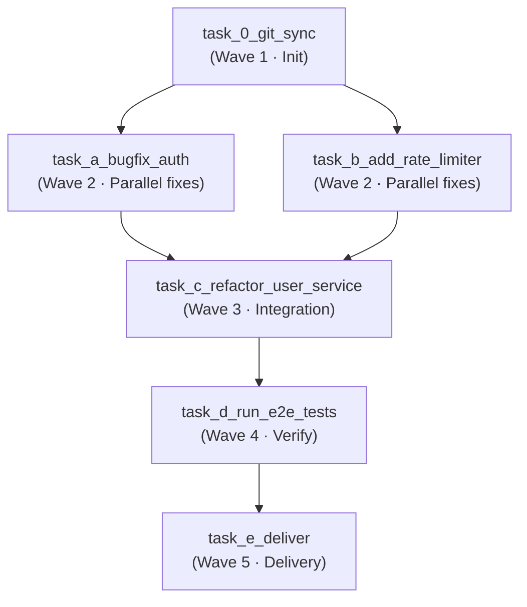

 [English](advanced-use-cases.md) | Русский

# Продвинутый сценарий: Feature & Bug Bundling в DAG-спринт

Более продвинутый сценарий, чем одиночная фича: вместо одной крупной задачи мы
собираем **релизный бандл** из нескольких мелких задач бэклога (багфикс,
небольшая фича и рефакторинг) в единый DAG-спринт и исполняем его в
`agent-orchestrator-lite` через OpenHands + Temporal.

Готовые JSON-планы из этого сценария лежат в файлах
[`feature-bundle.json`](../../examples/feature-bundle.json) (промпты на русском) и
[`feature-bundle-en.json`](../../examples/feature-bundle-en.json) (промпты на
английском) — любой из них можно запустить напрямую.

---

## Концепция: Feature/Bug Bundle

В классическом бэклоге мелкие задачи живут по отдельности: «починить
обновление сессии по refresh-токену», «добавить rate limiter», «вынести
`UserService` из контроллера». Запускать каждую из них отдельным воркфлоу
невыгодно:

- **Повторные накладные расходы.** Каждый отдельный спринт платит фиксированную
  цену `git-sync`, подготовки workspace, прогона тестов и доставки
  (commit + push + PR) — ради правки в несколько строк.
- **Последовательное ревью.** Каждая задача даёт собственный Pull Request,
  который нужно отдельно ревьюить и мержить.
- **Нет интеграционной безопасности.** Рефакторинг, затрагивающий код,
  изменённый багфиксом/фичей, тестируется только после мержа всего — когда
  конфликт или регрессия уже в `main`.

**Бандл** объединяет эти задачи в **один DAG-спринт с одной доставкой**:

- Независимые задачи кладутся в **одну волну** и исполняются параллельно
  (`asyncio.gather`), поэтому wall-clock определяется самой медленной задачей,
  а не их суммой.
- Задачи, затрагивающие общий код (рефакторинг поверх только что исправленной
  авторизации / ограниченного API), планируются **после** обоих родителей — DAG
  блокирует их до завершения параллельной волны.
- Один шаг проверки и один шаг доставки покрывают весь бандл → один PR с цельным
  описанием, одно ревью, один мерж.

DAG ниже — каноническая форма «релизного бандла»:

```
git_sync → (bugfix_auth ∥ add_rate_limiter) → refactor_user_service → run_e2e_tests → deliver
```

---

## Шаг 1. Описание бандла

Пример бандла для абстрактного веб-приложения состоит из трёх изменений плюс
проверка и доставка:

| # | Задача | Тип | Суть |
|---|---|---|---|
| A | `task_a_bugfix_auth` | Bugfix | Исправить продление сессии по refresh-токену в сервисе авторизации. |
| B | `task_b_add_rate_limiter` | Feature | Добавить rate limiter (429 + `Retry-After`) для публичного API. |
| C | `task_c_refactor_user_service` | Refactor | Вынести бизнес-логику из контроллера в слой `UserService`. |
| D | `task_d_run_e2e_tests` | Verify | E2E-тесты: продление сессии, путь 429 и базовые операции пользователя. |
| E | `task_e_deliver` | Delivery | Commit, push ветки `release/feature-bundle`, PR в `main`. |

Задачи A и B независимы → исполняются **параллельно**. Задача C затрагивает код,
изменённый и A, и B → стартует только после **обеих**. D проверяет весь бандл,
E доставляет его.

---

## Шаг 2. Запрос к LLM-архитектору (Claude / ChatGPT / DeepSeek)

Прикрепите документацию проекта (`ARCHITECTURE.md`, `API_SPEC.md`,
`DATABASE.md`) вместе с правилами построения DAG-графов из
[`AGENTS.md`](../../AGENTS.ru.md), затем отправьте следующий промпт:

```text
Я хочу выпустить релизный бандл: несколько мелких задач бэклога, объединённых
в один DAG-спринт.

Состав бандла:
- Bugfix: refresh-токен не продлевает сессию после истечения access-токена
  (пользователя выкидывает из системы).
- Feature: rate limiter для публичного API (HTTP 429 + Retry-After), настраивается
  через переменные окружения.
- Refactor: вынести пользовательскую бизнес-логику из контроллера в отдельный
  слой UserService, не меняя публичное поведение API.

Изучи прикреплённые ARCHITECTURE.md, API_SPEC.md, DATABASE.md и правила
построения DAG-графов из AGENTS.md.

Спроектируй бандл и выдай готовый ExecutionPlan в формате ВАЛИДНОГО JSON
(без markdown-фенсов), пригодный для отправки в agent-orchestrator-lite.

Требования к плану:
1. Первый шаг — git-sync: клонирование/обновление репозитория
   https://github.com/your-org/your-web-app (depends_on: []).
2. Разбей работу на 5 волн:
   - Wave 1 (Init): клонирование репозитория.
   - Wave 2 (параллельно):
       * Задача А — багфикс авторизации;
       * Задача Б — фича rate limiter.
   - Wave 3 (Integration): рефакторинг UserService — он ОБЯЗАН зависеть от ОБЕИХ
     задач Wave 2 (барьер перед правкой общего кода).
   - Wave 4 (Verify): e2e-тесты, покрывающие продление сессии, путь 429 и
     базовые операции пользователя.
   - Wave 5 (Delivery): commit, push ветки release/feature-bundle и создание
     Pull Request в main.
3. depends_on — строго по DAG: только на реально существующие id, без циклов.
   Задачи с одинаковым набором depends_on исполняются одной волной (параллельно).
4. Все шаги используют engine: "openhands".
5. Верни только JSON-объект с ключами "graph_name", "reasoning" и "tasks".
```

---

## Шаг 3. Получившийся DAG

Реалистичный ответ модели (тот же JSON, что и в
[`feature-bundle-en.json`](../../examples/feature-bundle-en.json)):


```json
{
  "graph_name": "Release Bundle: auth bugfix + rate limiter + UserService refactor",
  "reasoning": "Собираем мелкие задачи бэклога в один релизный DAG-спринт: параллельные фиксы (баг авторизации и новый rate limiter), затем интеграционный рефакторинг UserService, e2e-тесты и доставка через Pull Request.",
  "tasks": [
    {
      "id": "task_0_git_sync",
      "title": "Git Sync: clone репозиторий",
      "prompt": "Склонируй или обнови (git pull) репозиторий https://github.com/your-org/your-web-app в текущий рабочий каталог и подготовь рабочее окружение.",
      "priority": 1,
      "depends_on": [],
      "model": "deepseek-v4-flash",
      "engine": "openhands"
    },
    {
      "id": "task_a_bugfix_auth",
      "title": "Bugfix: продление сессии через refresh-токен",
      "prompt": "Исправь баг в сервисе авторизации: при истечении access-токена refresh-токен не продлевает сессию, и пользователь вылетает из системы. Убедись, что после обновления пары токенов сессия продолжается без повторного логина. Если меняется поведение эндпоинтов авторизации, обнови API_SPEC.md.",
      "priority": 2,
      "depends_on": ["task_0_git_sync"],
      "model": "deepseek-v4-pro",
      "engine": "openhands"
    },
    {
      "id": "task_b_add_rate_limiter",
      "title": "Feature: rate limiter для публичного API",
      "prompt": "Добавь rate limiter (скользящее окно или token bucket) для публичных эндпоинтов API. Лимит запросов и размер окна задавай через переменные окружения; при превышении лимита возвращай HTTP 429 с заголовком Retry-After. Обнови ARCHITECTURE.md описанием нового компонента.",
      "priority": 2,
      "depends_on": ["task_0_git_sync"],
      "model": "deepseek-v4-pro",
      "engine": "openhands"
    },
    {
      "id": "task_c_refactor_user_service",
      "title": "Refactor: выделить UserService",
      "prompt": "Отрефактори сервис пользователей: вынеси бизнес-логику из контроллера в отдельный сервисный слой UserService, сохранив публичное поведение API без изменений. Проверь, что правки из bugfix авторизации и rate limiter продолжают работать корректно.",
      "priority": 3,
      "depends_on": ["task_a_bugfix_auth", "task_b_add_rate_limiter"],
      "model": "deepseek-v4-pro",
      "engine": "openhands"
    },
    {
      "id": "task_d_run_e2e_tests",
      "title": "E2E: интеграционные тесты бандла",
      "prompt": "Напиши или запусти e2e-тесты, покрывающие: вход с продлением сессии через refresh-токен, отказ с HTTP 429 при превышении лимита запросов и базовые операции пользователя после рефакторинга. Запусти python -m py_compile по изменённым файлам и pytest; исправь найденные проблемы.",
      "priority": 4,
      "depends_on": ["task_c_refactor_user_service"],
      "model": "deepseek-v4-pro",
      "engine": "openhands"
    },
    {
      "id": "task_e_deliver",
      "title": "Delivery: commit, push, PR",
      "prompt": "Закоммить изменения понятным сообщением, запушь ветку release/feature-bundle через git push origin HEAD:refs/heads/release/feature-bundle и создай Pull Request в main с описанием всех изменений бандла (bugfix авторизации, rate limiter, рефакторинг UserService).",
      "priority": 5,
      "depends_on": ["task_d_run_e2e_tests"],
      "model": "deepseek-v4-flash",
      "engine": "openhands"
    }
  ]
}
```

### Как читать этот DAG



- `task_0_git_sync` выполняется первым и в одиночку — без клона правки упали бы
  на пустом workspace.
- `task_a_bugfix_auth` и `task_b_add_rate_limiter` не зависят друг от друга →
  запускаются **параллельно** одной волной через `asyncio.gather`. Волна длится
  столько, сколько самая медленная из двух задач, а не их сумма.
- `task_c_refactor_user_service` зависит от **обеих** задач Wave 2 → работает как
  **барьер**: рефакторинг трогает код, который только что изменили багфикс и
  фича, поэтому обязан дождаться завершения параллельной волны перед интеграцией.
- `task_d_run_e2e_tests` стартует только после рефакторинга, а `task_e_deliver` —
  только после зелёных e2e-тестов.

Это и есть выигрыш «бандла»: три независимых изменения из бэклога планируются
как **один** спринт с единственным интеграционным барьером, одной проверкой и
одной доставкой.


---

## Шаг 4. Запуск в agent-orchestrator-lite

### Вариант 1 — CLI (`scripts/agent-cli.py`)

В репозитории есть CLI без внешних зависимостей, который сам резолвит порты
сервисов из `.env`:

```bash
# Запуск спринта-бандла (auto-approve + дождаться завершения)
python3 scripts/agent-cli.py submit examples/feature-bundle.json --auto-approve --wait

# Или с английскими промптами
python3 scripts/agent-cli.py submit examples/feature-bundle-en.json --auto-approve --wait
```

Без `--auto-approve` план сначала ждёт ручного `APPROVE & DISPATCH` в
Human-in-the-Loop гейте. За прогрессом можно следить так:

```bash
python3 scripts/agent-cli.py status <workflow_id>
python3 scripts/agent-cli.py logs <workflow_id>
```

### Вариант 2 — cURL / REST API

```bash
curl -X POST http://127.0.0.1:${ORCHESTRATOR_GATEWAY_PORT:-8085}/api/v1/plan/direct \
  -H "Content-Type: application/json" \
  -d @examples/feature-bundle.json
```

Сразу без ручного подтверждения:

```bash
curl -X POST http://127.0.0.1:${ORCHESTRATOR_GATEWAY_PORT:-8085}/api/v1/plan/direct \
  -H "Content-Type: application/json" \
  -d "$(python3 -c 'import json; d=json.load(open("examples/feature-bundle.json")); print(json.dumps({"raw_json": json.dumps(d), "auto_approve": True}))')"
```

Прогресс — в Temporal UI (<http://127.0.0.1:8233>) по `workflow_id` из ответа
API (`{"status": "triggered", "workflow_id": "direct-plan-..."}`).

> **Про репозиторий-заглушку.** В плане используется
> `https://github.com/your-org/your-web-app` — замени его на URL своего проекта
> перед запуском (в промпте `task_0_git_sync` и в поле `graph_name` при желании).

