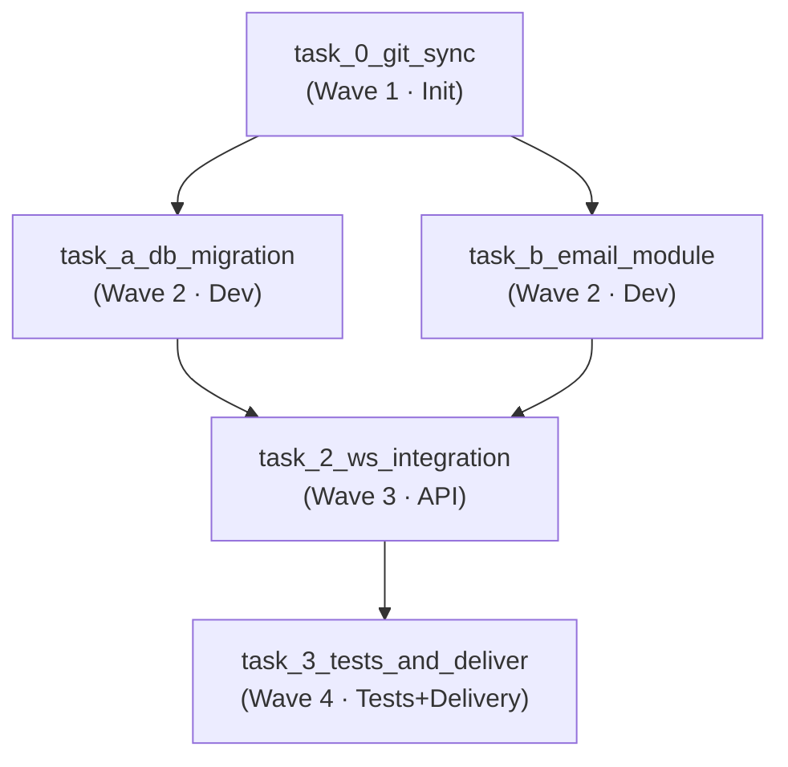

 English | [Русский](notification-service.ru.md)

# End-to-end tutorial: building a feature with ChatGPT + agent-orchestrator-lite

A complete start-to-finish scenario: how to use an external LLM chat (ChatGPT /
Claude) to design a DAG plan for a feature and execute it in
`agent-orchestrator-lite` via OpenHands + Temporal.

The ready-made JSON plan from this scenario lives in the file
[`notification-service.json`](../../examples/notification-service.json) — you can
run it directly.

---

## Scenario: a notification system (Notification Service)

We add a notification service over **WebSocket** and **Email** to an abstract web
application. The feature touches three layers:

- **DB** — a new `notifications` table;
- **Service layer** — an Email sending module;
- **API/Transport** — a WebSocket endpoint + Email and DB integration.

---

## Step 1. Preparing the project documentation

The developer takes four files from their project and from the orchestrator:

| File | What it contains |
|---|---|
| `ARCHITECTURE.md` | Application architecture: layers, modules, extension points. |
| `API_SPEC.md` | REST API (OpenAPI) specification and the existing endpoints. |
| `DATABASE.md` | DB schema: SQLAlchemy / Prisma models, migrations. |
| `AGENTS.md` | Rules for building DAG graphs for the orchestrator (waves, `depends_on`, workspace isolation, OpenHands constraints). |

> In `agent-orchestrator-lite` the DAG-building rules are described in
> [`README.md`](../../README.md) → the "JSON plan format" section, in
> [`self-update.md`](self-update.md) and in [`AGENTS.md`](../../AGENTS.md).
> These are exactly the rules to attach to the request so that the LLM generates
> a plan in the right format.

---

## Step 2. The request to ChatGPT / Claude

We copy the prompt below together with the attached `ARCHITECTURE.md`, `API_SPEC.md`,
`DATABASE.md` and the DAG rules:

```text
I want to add a notification service over WebSocket and Email to the project.

Study the attached ARCHITECTURE.md, API_SPEC.md, DATABASE.md and the DAG-building
rules from AGENTS.md.

Design the feature and produce a ready-made ExecutionPlan in VALID JSON format
(no markdown fences), suitable for sending to agent-orchestrator-lite.

Plan requirements:
1. The first step — git-sync: clone/update the repository
   https://github.com/your-org/your-web-app (depends_on: []).
2. Split the work into 4 waves:
   - Wave 1 (Init): clone the repository.
   - Wave 2 (in parallel):
       * Task A — DB migration + the Notification model;
       * Task B — a dedicated Email sending module.
   - Wave 3 (Integration & API): the /ws/notifications WebSocket endpoint and
     integration with Email + DB.
   - Wave 4 (Tests & Delivery): pytest tests, build verification, commit,
     push to the feature/notification-service branch and open a Pull Request.
3. depends_on — strictly a DAG: only references to ids that actually exist, no cycles.
   Tasks with the same set of depends_on are executed in one wave (in parallel).
4. All steps use engine: "openhands".
5. Return only a JSON object with the keys "graph_name", "reasoning" and "tasks".
```

---

## Step 3. ChatGPT's answer — the ready-made JSON plan

A realistic model answer (the same JSON as in
[`notification-service.json`](../../examples/notification-service.json)):

```json
{
  "graph_name": "Notification Service: WebSocket + Email",
  "reasoning": "Добавляем сервис уведомлений: миграция БД и модель Notification, выделенный модуль Email-отправки, WebSocket-эндпоинт с интеграцией, pytest-тесты и доставка через Pull Request.",
  "tasks": [
    {
      "id": "task_0_git_sync",
      "title": "Git Sync: clone репозиторий",
      "prompt": "Склонируй или обнови (git pull) репозиторий https://github.com/your-org/your-web-app в текущий рабочий каталог и подготовь рабочее окружение.",
      "priority": 1,
      "depends_on": [],
      "model": "deepseek-v4-flash",
      "engine": "openhands"
    },
    {
      "id": "task_a_db_migration",
      "title": "DB: миграция и модель Notification",
      "prompt": "Создай миграцию базы данных и модель Notification (id, user_id, type, payload, read, created_at). Используй существующий ORM проекта (SQLAlchemy/Prisma) и обнови DATABASE.md описанием новой таблицы.",
      "priority": 2,
      "depends_on": ["task_0_git_sync"],
      "model": "deepseek-v4-pro",
      "engine": "openhands"
    },
    {
      "id": "task_b_email_module",
      "title": "Email: выделенный модуль отправки",
      "prompt": "Создай выделенный модуль email-отправки: функция send_email(to, subject, body) через SMTP/API-провайдер, конфигурация через переменные окружения и простые шаблоны писем. Обнови ARCHITECTURE.md описанием модуля.",
      "priority": 2,
      "depends_on": ["task_0_git_sync"],
      "model": "deepseek-v4-pro",
      "engine": "openhands"
    },
    {
      "id": "task_2_ws_integration",
      "title": "API: WebSocket-эндпоинт и интеграция",
      "prompt": "Добавь WebSocket-эндпоинт /ws/notifications, доставляющий уведомления подписанным клиентам. Интегрируй его с моделью Notification и модулем Email: при создании уведомления одновременно отправляй WebSocket-сообщение и Email. Обнови API_SPEC.md описанием нового эндпоинта.",
      "priority": 3,
      "depends_on": ["task_a_db_migration", "task_b_email_module"],
      "model": "deepseek-v4-pro",
      "engine": "openhands"
    },
    {
      "id": "task_3_tests_and_deliver",
      "title": "Tests & Delivery",
      "prompt": "Напиши pytest-тесты для модели Notification, модуля Email и WebSocket-эндпоинта. Запусти python -m py_compile по изменённым файлам и pytest; исправь найденные проблемы. Затем закоммить изменения понятным сообщением, запушь ветку feature/notification-service и создай Pull Request в main с описанием фичи.",
      "priority": 4,
      "depends_on": ["task_2_ws_integration"],
      "model": "deepseek-v4-pro",
      "engine": "openhands"
    }
  ]
}
```

### How to read this DAG



- `task_0_git_sync` runs first and alone — without the clone, the edits would fail
  on an empty workspace.
- `task_a_db_migration` and `task_b_email_module` do not depend on each other →
  they are launched **in parallel** in one wave via `asyncio.gather`.
- `task_2_ws_integration` depends on both Wave 2 tasks → it waits for them to finish.
- `task_3_tests_and_deliver` starts only after a successful integration.

---

## Step 4. Running in agent-orchestrator-lite

### Option 1 — Streamlit UI

1. Open the Streamlit Dashboard: <http://127.0.0.1:${STREAMLIT_PORT:-8501}>.
2. Paste the JSON you got from ChatGPT into the "**Готовый JSON-план**"
   ("Ready-made JSON plan") field (or copy the content of
   [`notification-service.json`](../../examples/notification-service.json)).
3. Tick the "**⚡ Auto-approve (запустить без ручного подтверждения)**" checkbox to
   skip manual confirmation (or leave it off — then the plan has to be approved
   manually in the monitoring panel first).
4. Click "**⚡ Запустить с готовым JSON-планом**" ("Run with the ready-made JSON plan").
5. Watch the execution of the DAG waves in the "**Мониторинг и управление
   workflow**" ("Workflow monitoring and management") panel: enter the
   `workflow_id` that appears and follow the status of the Temporal Workflow.
6. When it finishes, you get a link to the ready-made Pull Request on GitHub
   (branch `feature/notification-service` → `main`).

### Option 2 — cURL / REST API

```bash
curl -X POST http://127.0.0.1:${ORCHESTRATOR_GATEWAY_PORT:-8085}/api/v1/plan/direct \
  -H "Content-Type: application/json" \
  -d @examples/notification-service.json
```

Immediately, without manual confirmation:

```bash
curl -X POST http://127.0.0.1:${ORCHESTRATOR_GATEWAY_PORT:-8085}/api/v1/plan/direct \
  -H "Content-Type: application/json" \
  -d "$(python3 -c 'import json; d=json.load(open("examples/notification-service.json")); print(json.dumps({"raw_json": json.dumps(d), "auto_approve": True}))')"
```

Progress — in the Temporal UI (<http://127.0.0.1:8233>) by the `workflow_id` from
the API response (`{"status": "triggered", "workflow_id": "direct-plan-..."}`).

> **About the stub repository.** The plan uses
> `https://github.com/your-org/your-web-app` — replace it with the URL of your own
> project before running (in the `task_0_git_sync` prompt and, optionally, in the
> `graph_name` field).
