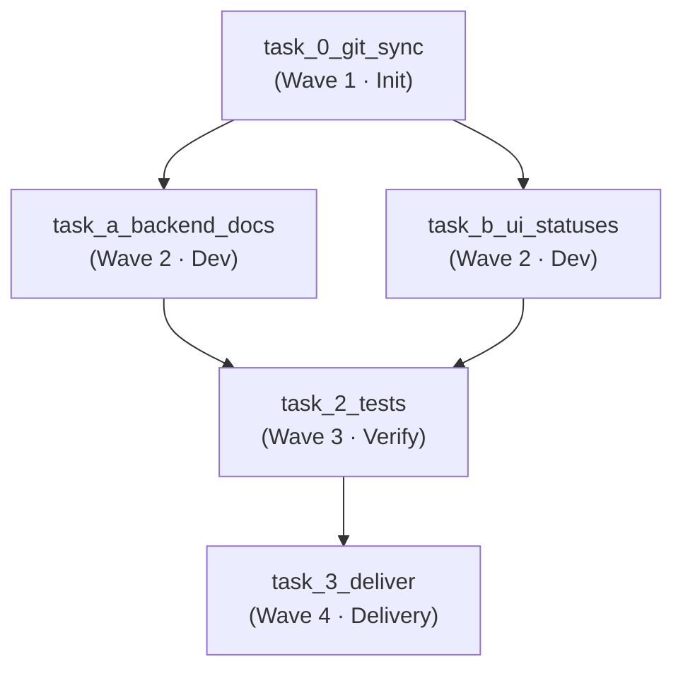

 English | [Русский](self-update.ru.md)

# Example sprint: repository self-update

In this example the `agent-orchestrator-lite` orchestrator updates **its own
code**. The ready-made JSON plan lives in the file
[`self-update.json`](../../examples/self-update.json) — you can paste it into the
Streamlit UI or send it directly to `POST /api/v1/plan/direct`.

## Concept

The OpenHands agent, driven by the Temporal workflow, receives a DAG plan of 5
tasks split into 4 waves. Each task runs in an isolated workspace
`/app/workspace/runs/{workflow_id}`, and parallelism is defined exclusively by
the `depends_on` field: tasks with the same set of dependencies are launched in
one wave via `asyncio.gather`.

The wave executor works strictly according to the submitted plan:
- first only `task_0_git_sync` starts (Wave 1);
- after it succeeds, `task_a_backend_docs` and `task_b_ui_statuses` start in
  parallel (Wave 2);
- after both of them — `task_2_tests` (Wave 3);
- and only after the tests pass — `task_3_deliver` (Wave 4).

If a task fails, the tasks depending on it are skipped (fault isolation), and the
failed one is recorded in the workflow summary.

## DAG graph by waves



### Wave 1 — Init

| Field | Value |
|---|---|
| `id` | `task_0_git_sync` |
| `depends_on` | `[]` |
| Essence | Clones/updates `https://github.com/kartemiev/agent-orchestrator-lite` into the workspace and prepares the environment. |

The first step always runs alone: without a cloned repository the subsequent
edit tasks would fail on an empty workspace.

### Wave 2 — Parallel development

Two independent tasks share the same parent `task_0_git_sync` and therefore run
**simultaneously** in one wave.

| `id` | Task | Essence |
|---|---|---|
| `task_a_backend_docs` | Backend/Docs | Adds `GET /health/details` to `orchestrator/main.py` and documents it in `README.md`. |
| `task_b_ui_statuses` | Frontend/UI | Improves the rendering of the workflow status and task summary in `ui/app.py`. |

### Wave 3 — Tests & Verification

| Field | Value |
|---|---|
| `id` | `task_2_tests` |
| `depends_on` | `["task_a_backend_docs", "task_b_ui_statuses"]` |
| Essence | Runs `python -m py_compile` over all Python files and fixes the issues it finds. |

Depends on **both** Wave 2 tasks — verification starts only when both the backend
and the UI are finished.

### Wave 4 — Delivery

| Field | Value |
|---|---|
| `id` | `task_3_deliver` |
| `depends_on` | `["task_2_tests"]` |
| Essence | Commits the changes, pushes the `feature/self-update` branch and opens a Pull Request into `main`. |

Delivery comes last and only with green tests.

> **A note on the built-in delivery.** Besides the explicit `task_3_deliver` step,
> at the end of any workflow the orchestrator worker additionally calls the
> `git_push_and_create_pr` activity — a safety net against losing
> uncommitted/unpushed changes. If the explicit delivery step has already created
> a PR, the built-in activity may create one more PR on the `feature/{workflow_id}`
> branch. For a clean delivery you can either drop `task_3_deliver` and rely on
> the built-in mechanism, or keep the explicit step and close the duplicate PR
> manually.

## Running

### Option 1 — Streamlit UI

1. Open `http://127.0.0.1:${STREAMLIT_PORT:-8501}`.
2. Open the file [`self-update.json`](../../examples/self-update.json) and copy its
   content in full.
3. Paste the JSON into the "**Готовый JSON-план**" ("Ready-made JSON plan") field.
4. Tick the "**⚡ Auto-approve (запустить без ручного подтверждения)**" checkbox —
   the plan is approved automatically and the Human-in-the-Loop gate is skipped.
5. Click "**⚡ Запустить с готовым JSON-планом**" ("Run with the ready-made JSON plan").
6. In the "**Мониторинг и управление workflow**" ("Workflow monitoring and
   management") panel enter the `workflow_id` that appears and watch the status
   (with Auto-approve off, the `APPROVE & DISPATCH` and "Отклонить запуск"
   ("Reject run") buttons appear there as well).

### Option 2 — cURL / REST API

```bash
curl -X POST http://127.0.0.1:${ORCHESTRATOR_GATEWAY_PORT:-8085}/api/v1/plan/direct \
  -H "Content-Type: application/json" \
  -d @examples/self-update.json
```

Expected response:

```json
{
  "status": "triggered",
  "workflow_id": "direct-plan-...",
  "mode": "direct_json_plan",
  "task_count": 5,
  "auto_approve": false
}
```

Run immediately without manual confirmation (Auto-approve):

```bash
curl -X POST http://127.0.0.1:${ORCHESTRATOR_GATEWAY_PORT:-8085}/api/v1/plan/direct \
  -H "Content-Type: application/json" \
  -d "$(python3 -c 'import json; d=json.load(open("examples/self-update.json")); print(json.dumps({"raw_json": json.dumps(d), "auto_approve": True}))')"
```

Or wrap the plan into the `raw_json` key by hand:

```bash
curl -X POST http://127.0.0.1:${ORCHESTRATOR_GATEWAY_PORT:-8085}/api/v1/plan/direct \
  -H "Content-Type: application/json" \
  -d '{"raw_json": "<content of examples/self-update.json on a single line>", "auto_approve": true}'
```

After the run you can follow the progress in the Temporal UI (`http://127.0.0.1:8233`)
or via `GET /api/v1/...`/the Temporal client by `workflow_id`.

## What to expect as a result

- A Pull Request from the `feature/self-update` branch into `main` with changes to
  `orchestrator/main.py`, `ui/app.py` and `README.md` will appear in the
  `kartemiev/agent-orchestrator-lite` repository.
- The Temporal UI will show the workflow history: 4 waves, parallel execution of
  Wave 2, fault isolation between tasks.
